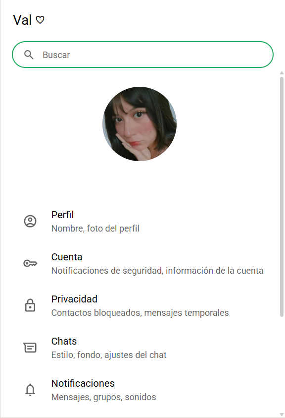
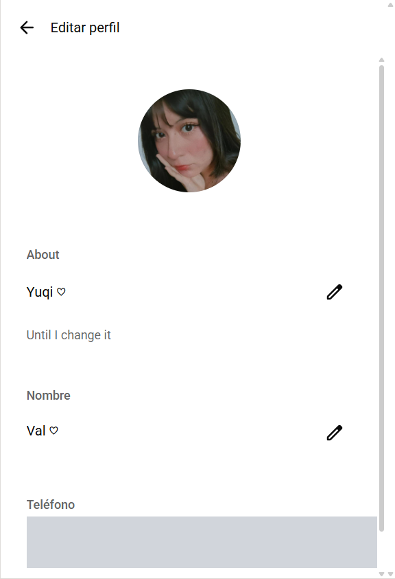
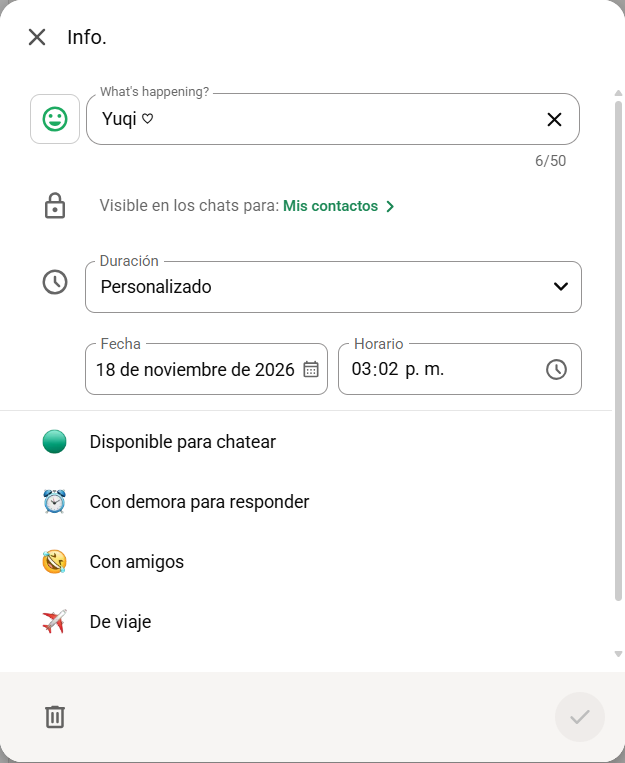

# HU-01: Cambiar el About de WhatsApp Web

**Como** titular de una cuenta de WhatsApp con la sesión ya iniciada,
**quiero** cambiar el texto de mi About desde WhatsApp Web,
**para** comunicar mi disponibilidad o información personal a quienes puedan verla.

> **Evidencia del 17 de noviembre de 2026.** Las cuatro capturas se tomaron con Playwright conectado a la pestaña de WhatsApp Web que el titular ya tenía abierta en Chrome. El nombre de perfil **Val ♡** y el avatar aparecen en las capturas 02 y 03.
>
> La prueba llegó hasta el editor, verificó que **Guardar** estaba deshabilitado al abrirlo y confirmó que el About original seguía visible después de cerrarlo.
>
> En la interfaz observada, el perfil muestra **About** y el diálogo de edición se titula **Info.**. El script utiliza roles y nombres accesibles, con pausas de 1 a 2,5 segundos entre acciones.

## Precondiciones

- Tener una cuenta propia vinculada a WhatsApp Web y una conexión a Internet.
- Disponer de una sesión iniciada por el titular. Si aparece el inicio de sesión, el titular debe completarlo manualmente.
- Para usar una ventana de Chrome ya abierta, habilitar la depuración remota en `chrome://inspect/#remote-debugging` y aceptar el aviso de conexión de Chrome. Si WhatsApp pide vincular un dispositivo, el titular debe hacerlo desde su teléfono.

## Criterios de aceptación y recorrido

### 1. Acceder a la cuenta desde «Tú»

**Dado** que la sesión está iniciada,
**cuando** selecciono mi avatar, identificado como **Tú**, en la parte inferior de la barra lateral,
**entonces** se abre el panel de mi cuenta.

Locator: `getByRole('button', { name: 'Tú', exact: true })`.

**Verificado:** el control está disponible y abre el panel del titular. La captura muestra únicamente la barra de navegación para excluir las conversaciones.


### 2. Seleccionar «Perfil»

**Dado** que estoy en el panel de mi cuenta,
**cuando** selecciono **Perfil**,
**entonces** se abre la pantalla **Editar perfil**.

Locator observado en esta sesión `getByRole('button', { name: 'Perfil Nombre, foto del perfil', exact: true })`.

**Verificado.** El panel muestra el nombre **Val ♡**, el avatar y el acceso a Perfil.



### 3. Localizar el About y abrir su edición

**Dado** que estoy en **Editar perfil**,
**cuando** selecciono el lápiz situado a la derecha del texto de **About**,
**entonces** se abre el diálogo **Info.** con el texto actual.

Locator del lápiz: `getByRole('button', { name: 'Botón de editar para la creación de estados de texto', exact: true })`.

**Verificado:** el perfil muestra el About actual y un lápiz específico para editarlo. El nombre accesible del lápiz difiere de la etiqueta visual del campo. Se ocultó la fila del teléfono en la captura.



### 4. Consultar el editor y preparar el nuevo texto

**Dado** que el diálogo **Info.** está abierto,
**cuando** consulto sus controles,
**entonces** puedo identificar el campo del About, su contador y las opciones que acompañan al texto.

Locators observados:

- Diálogo: `getByRole('dialog')`.
- Título: `getByRole('heading', { name: 'Info.', exact: true })`.
- Campo de About dentro del diálogo. El script usa `dialogo.getByRole('textbox').and(dialogo.locator('input[type="text"]'))` para distinguirlo de los controles de fecha y horario. La etiqueta visual observada es **What's happening?**.
- Visibilidad en chats. La sesión muestra **Mis contactos**.
- Duración: botón **Personalizado**, en la sesión observada.

**Verificado.** El editor carga el texto actual y muestra un contador **6/50**, visibilidad, duración, fecha, horario y sugerencias. El botón de confirmación tiene nombre accesible **Guardar** y está deshabilitado al abrir el editor sin cambios.

Reemplaza el contenido del campo por el texto deseado, por ejemplo «Disponible por la tarde». La interfaz observada muestra un límite de 50 caracteres. Revisa la visibilidad y la duración antes de guardar.

**No ejecutado:** escritura del texto, selección de sugerencias y cambios de visibilidad o duración. No se probó la validación del límite ni el comportamiento ante valores inválidos.



### 5. Guardar el About (no ejecutado en esta prueba)

**Dado** que introduje un texto válido y revisé las opciones,
**cuando** confirmo mediante **Guardar**, representado por una marca de verificación en la esquina inferior derecha,
**entonces** el resultado esperado es que el nuevo About quede guardado y se muestre en mi perfil.

Locator: `getByRole('dialog').getByRole('button', { name: 'Guardar', exact: true })`.

La captura 04 muestra el control de confirmación. Se documentó hasta el diálogo abierto y se cerró sin confirmar. **El guardado, su persistencia y la visualización desde otras cuentas quedan pendientes de validación.**

### 6. Cerrar el editor sin guardar

**Dado** que abrí el editor sin realizar cambios,
**cuando** selecciono la **X** de la esquina superior izquierda,
**entonces** se cierra el diálogo y sigue visible el About original en el perfil.

Locator: `getByRole('dialog').getByRole('button', { name: 'Cerrar', exact: true })`.

**Verificado:** se cerró el diálogo y se comprobó que el texto original seguía visible. No se añade otra captura porque el perfil vuelve al mismo estado mostrado en la captura 03. No se comprobó el descarte de un borrador modificado.

## Script reproducible

Archivo: [script.js](script.js), en esta misma carpeta.

El script reproduce la navegación y toma cuatro capturas. Cierra el editor sin escribir ni guardar. Comprueba el nombre del titular en el menú y en el perfil mediante `nombreCuenta`. Para usar otra cuenta propia, configura esa constante con el nombre que muestra WhatsApp.

Con la sesión de playwright-cli ya abierta en el perfil persistente del titular, ejecutar desde esta carpeta:

```powershell
playwright-cli.cmd run-code --filename=script.js
```

La carpeta `capturas/` debe existir. Si mueves la HU, actualiza la constante `out` al inicio del script. Cada ejecución sobrescribe las capturas. Actualiza la fecha y el alcance de la evidencia en la historia si repites la prueba.

## Evidencia y limitaciones

- La interfaz observada combina etiquetas en español e inglés. Si cambia el idioma o la versión de WhatsApp Web, puede ser necesario ajustar los nombres accesibles y los contenedores de captura.
- La visibilidad y la duración se observaron, pero no se abrieron sus opciones ni se validaron sus efectos.
- No se ejecutaron el guardado, la eliminación del About, la sincronización con el teléfono ni comprobaciones desde otras cuentas.
- El estado de Guardar después de introducir cambios válidos es un resultado esperado pendiente de prueba.

## Privacidad

Las capturas se encuadraron para excluir conversaciones y se ocultó el teléfono en el perfil. El nombre, el avatar y el About aparecen como evidencia de sesión. Antes de compartir la carpeta o exportarla a PDF, revisa si conviene ocultar esos datos.

## Fuentes oficiales consultadas

- WhatsApp restringe la mensajería automática, el acceso no autorizado y la recopilación no autorizada. [Condiciones del servicio de WhatsApp](https://www.whatsapp.com/legal/terms-of-service?lang=es)
- Los pasos y nombres de controles proceden de las pantallas capturadas. [Centro de ayuda de WhatsApp sobre la edición del perfil](https://faq.whatsapp.com/859240711908360/?cms_platform=web)
